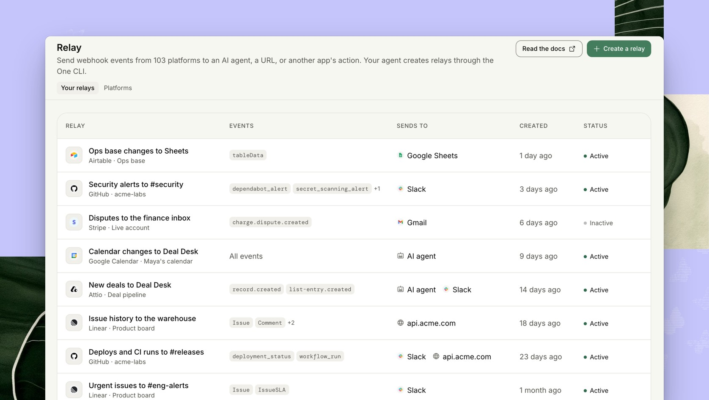
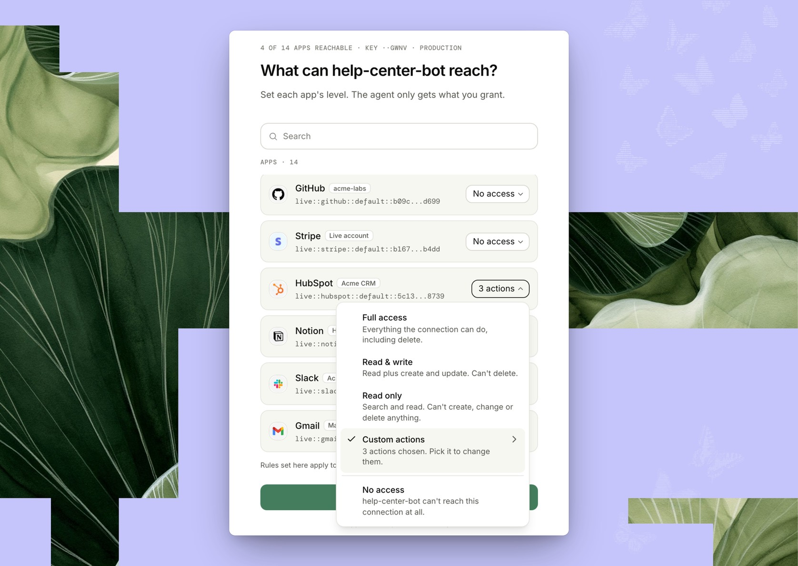
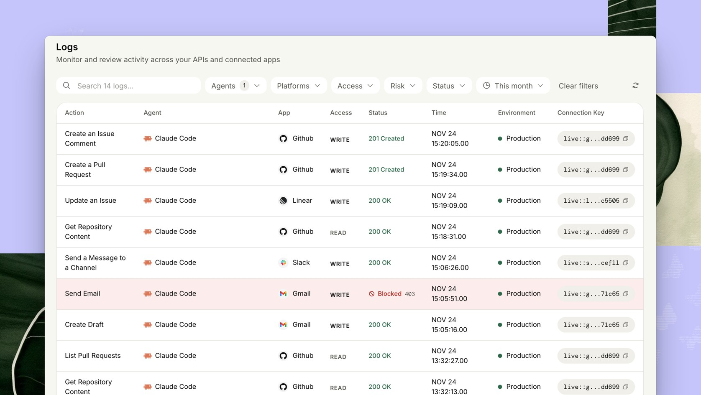

<p>
  <a href="https://withone.ai/products/cli">
    <picture>
      <source media="(prefers-color-scheme: dark)" srcset="https://raw.githubusercontent.com/withoneai/cli/main/assets/banner-dark.svg">
      
    </picture>
  </a>
</p>

<h3 align="center">One CLI</h3>

<p align="center">
  <a href="https://withone.ai/docs/getting-started"><strong>Get started</strong></a>
  &nbsp;&middot;&nbsp;
  <a href="https://withone.ai/docs/cli"><strong>Docs</strong></a>
  &nbsp;&middot;&nbsp;
  <a href="./docs"><strong>Reference</strong></a>
  &nbsp;&middot;&nbsp;
  <a href="https://withone.ai/knowledge"><strong>API directory</strong></a>
  &nbsp;&middot;&nbsp;
  <a href="https://app.withone.ai"><strong>Dashboard</strong></a>
  &nbsp;&middot;&nbsp;
  <a href="https://withone.ai/changelog"><strong>Changelog</strong></a>
</p>

<p align="center">
  <a href="https://npmjs.com/package/@withone/cli"></a>
  &nbsp;
  <a href="https://withone.ai/knowledge"></a>
  &nbsp;
  <a href="https://withone.ai/knowledge"></a>  &nbsp;
  <a href="./LICENSE"></a>
</p>

The One CLI puts the apps you have connected on One at your agent's command line. One command finds the action a task needs and returns its real API documentation. The next one runs it. One holds the credentials and adds them on its side, which means your agent never sees an OAuth token or a platform API&nbsp;key.

It is built to be driven by an agent and works the same by hand. Add `--agent` and every command answers in&nbsp;JSON.

## Quick start

### With your agent

Install the One skill, then hand the rest to your&nbsp;agent.

```bash
npx skills add withoneai/cli -g
```

Then send your agent this&nbsp;message.

```text
Use the One skill to set up the One CLI, then run "one onboard"
```

Your agent installs the CLI and opens your browser, where you sign in and choose what its key can reach. Then it runs `one onboard`, a three-step script written for an agent, which teaches it the commands and shows it which apps you have connected. Connect a first app with `one add gmail`, which you approve in your&nbsp;browser.

### By hand

```bash
npx @withone/cli@latest init
```

`one init` signs you in through the browser, installs the One skill into the coding agents you pick and offers to connect your first app. To keep `one` on your path, install it&nbsp;globally.

```bash
npm install -g @withone/cli
one init
```

It needs Node.js 22.23.4+, 24.22.1+ or 26.12.1+. If the global install fails with a permissions error, run each command through `npx @withone/cli@latest`&nbsp;instead.

Then four commands take you from nothing to a sent&nbsp;email.

```bash
# Connect an app. Your browser opens, you approve, and it is connected
one add gmail

# See what you are connected to, and what this key may run on each app
one list

# Find the action for the job, with its documentation
one actions find gmail "send an email" --task "email a hello to a contact"

# Run it
one actions execute gmail <actionId> <connectionKey> \
  -d '{"to": "jane@example.com", "subject": "Hello", "body": "Sent from my agent"}'
```

`one list` gives you the connection key that `execute`&nbsp;takes.

```
     Platform  Status       Connection Key                  Access
  ─  ────────  ───────────  ──────────────────────────────  ───────────
  ●  gmail     operational  live::gmail::default::abc123    Full access
  ●  slack     operational  live::slack::default::def456    Read only
  ●  shopify   operational  live::shopify::default::ghi789  Read & write
```

Once you are set up by hand, ask your agent to run `one onboard` and it learns the same&nbsp;way.

## How it works

```
Your agent
    ↓
One CLI
    ↓
One API    checks the access, adds the credentials, records the call
    ↓
Gmail · Slack · Shopify · HubSpot · Stripe · every other platform
```

Every call to an app goes through One. One checks the call against what your key may do, adds the credentials for the connection, makes the request and records it. A connection key names a connection. It is not a&nbsp;credential.

Every task follows the same three steps, whatever the&nbsp;platform.

| Step | Command | What it&nbsp;answers |
|------|---------|-----------------|
| 1 | `one list` | What am I connected to, and what may I run&nbsp;there? |
| 2 | `one actions find` | Which action does this, and how do I call&nbsp;it? |
| 3 | `one actions execute` | Do&nbsp;it |

Read the documentation `find` returns before you execute. It holds the required parameters and the platform's&nbsp;quirks.

## What you can do

### Run actions

Find the action for every step of a task in one call, across platforms, then run each one. `--dry-run` shows the request without sending it, `--mock` returns an example response, and `--parallel` runs several actions at&nbsp;once.

```bash
one actions find hubspot "find a contact by email" gmail "send an email" \
  --task "email a follow-up to a CRM contact"

one actions execute stripe <actionId> <connectionKey> --query-params '{"limit": "10"}'
one actions execute shopify <actionId> <connectionKey> --path-vars '{"order_id": "12345"}' --dry-run
```

See [Connections](./docs/connections.md) and [Actions](./docs/actions.md) in the&nbsp;reference.

### Chain them into flows

A flow is a multi-step workflow written as JSON, saved under `.one/flows/`. Flows have conditions, loops, parallel steps, transforms, pagination, sub-flows, code and bash steps. A run can be dry-run, stopped after any step, paused, resumed and inspected step by&nbsp;step.

```bash
one flow scaffold loop | one flow create my-loop     # start from a template, then fill in its actions
one flow validate my-loop
one flow execute my-loop --dry-run                   # resolve every step without running it
one flow execute my-loop
```

See [Flows](./docs/flows.md) in the reference, or run `one guide flows` for the full&nbsp;schema.

### Sync app data into local memory

`one sync` pulls a platform's records into a local Postgres store that starts by itself on first use. Query, search and join them without another API call, keep them fresh on a schedule, and run a command when a record changes. `one mem` holds your agent's own notes in the same&nbsp;store.

```bash
one sync init stripe customers                       # a profile from the built-in
one sync run stripe                                  # pull the records into memory
one sync query stripe/customers --where 'address.city=SF'
one sync schedule add stripe --every 1h

one mem add note '{"content":"Design review is Thursday"}' --tags work
one mem search "design review"
```

See [Memory and sync](./docs/memory-and-sync.md) in the&nbsp;reference.

### React to webhooks

`one relay` receives a platform's webhook events on One and forwards each one to another app's action, a URL or an agent, with no server of your&nbsp;own.

```bash
one relay platforms                                  # which platforms can send events
one relay event-types stripe
one relay create --connection-key <key> --create-webhook --event-filters '["customer.created"]'
one relay activate <id> --actions '<json>'           # forward each event to an action
```

<p>
  
</p>

See [Relay](./docs/relay.md) in the reference and&nbsp;the&nbsp;[Relay&nbsp;docs](https://withone.ai/docs/relay).

### Build One into your product

[Connect](https://github.com/withoneai/connect) is One's embeddable authentication. You add it to your product, and your users connect their own apps there. The CLI installs the Connect skill for your coding agent, creates the Connect app from a typed `one.connect.ts`, and can act for one of your users within what that user&nbsp;granted.

```bash
one skills add connect        # the One Connect skill, into this project
one connect types             # tool slugs and action names autocomplete in one.connect.ts
one connect create            # review and approve the app in the browser
```

See [Connect](./docs/connect.md) in the&nbsp;reference.

## Built for agents

- **JSON on request.** Put `--agent` right after `one`, or set `ONE_AGENT=1`, for JSON on stdout with no colors, spinners or prompts. A failure prints `{"error": "..."}` and exits&nbsp;1.
- **Writes wait for a yes.** In agent mode an action that writes or deletes returns `confirmation_required` and sends nothing until the command carries `--confirm-write`. Flows need `--allow-bash` and `--allow-code` before a bash step or a code module&nbsp;runs.
- **A skill that stays current.** `one init` installs the [One skill](./skills/one) for Claude Code, Claude Desktop and Codex, and for Cursor, Windsurf, Kiro, Goose, Amp, OpenCode and Roo when you pick them. `npx skills add withoneai/cli -g` installs it before the CLI is there. The CLI refreshes the skill whenever its own version&nbsp;changes.
- **A guide inside the binary.** An agent with nothing but the binary can run `one --agent guide` and get the whole manual as JSON. The topics are `overview`, `actions`, `flows`, `relay`, `cache`, `memory` and&nbsp;`sync`.

The [One MCP server](https://github.com/withoneai/mcp) gives an agent the same three steps as tools, over the same&nbsp;connections.

| MCP&nbsp;tool | CLI&nbsp;command |
|----------|-------------|
| `list_one_integrations` | `one list` |
| `find_one_actions` | `one actions find`, and `one actions load` for more of a&nbsp;document |
| `execute_one_action` | `one actions execute` |

See [Agents](./docs/agents.md) in the&nbsp;reference.

## Access and security

Your agent never handles a platform credential. One stores the OAuth tokens and API keys for your connections and adds them on its side on each&nbsp;call.

**You choose what the key can reach.** `one login` opens a consent page in your browser. There you name the key and give it all your connections, specific ones at a level each, or Knowledge only, which reads API documentation and runs nothing. Change it later from Manage access in the [One dashboard](https://app.withone.ai). One enforces the key's access on every&nbsp;call.

<p>
  
</p>

**You can narrow it further on your machine.** `one config` sets a permission level of `read`, `write` or `admin`, an allowlist of connections, an allowlist of actions and a knowledge-only mode. These settings can only lower what the key was granted. A `.onerc` file in a project can only narrow them too, because it can arrive with a cloned&nbsp;repository.

**Every call is on the record.** One records each action with the agent that ran it, the app, the access it used and the result. A call outside the key's access is refused before it reaches the app, and the Logs page shows that&nbsp;too.

<p>
  
</p>

The CLI sends usage analytics, which never include command arguments, inputs, connection data or secrets. `ONE_NO_TELEMETRY=1` or `DO_NOT_TRACK=1` turns them&nbsp;off.&nbsp;See&nbsp;[Setup](./docs/setup.md#telemetry).

## Commands

| Command | What it&nbsp;does |
|---------|--------------|
| `one init` | Sign in, install the One skill and connect a first&nbsp;app |
| `one login`,&nbsp;`one logout` | Sign in through the browser, or clear local&nbsp;credentials |
| `one whoami` | The user, organization, project, environment and key in&nbsp;use |
| `one add <platform>` | Connect an app through&nbsp;OAuth |
| `one list` | Your connections, their keys and your access on&nbsp;each |
| `one connection delete <key>` | Remove a&nbsp;connection |
| `one platforms` | Every platform you can&nbsp;connect |
| `one actions find` | The action for each operation a task needs, with its&nbsp;documentation |
| `one actions load` | More of an action's&nbsp;documentation |
| `one actions execute` | Run an action on a&nbsp;connection |
| `one cache` | The local cache of action&nbsp;documentation |
| `one flow` | Create, validate, execute, resume and inspect multi-step&nbsp;workflows |
| `one mem` | The local memory store of notes and synced&nbsp;records |
| `one sync` | Sync a platform's records into memory, on demand or on a&nbsp;schedule |
| `one relay` | Receive webhook events and forward them to&nbsp;actions |
| `one connect` | Create and update a Connect app from&nbsp;`one.connect.ts` |
| `one skills` | Optional skills for your coding&nbsp;agent |
| `one config` | Access control, the active config and the installed&nbsp;skill |
| `one guide`,&nbsp;`one onboard` | The built-in manual, and a three-step introduction for an&nbsp;agent |
| `one update` | Update the CLI. It also updates itself in the&nbsp;background |

`one --help` prints all of them, and `one <command> --help` prints a command's options. Every flag, default and output shape is in the&nbsp;[reference](./docs).

## Configuration

`one init` asks whether the setup is global or for one project. A global config lives in `~/.one/config.json`. A project config lives under `~/.one/projects/`, outside the repository, where a secret cannot land in git. In a project the CLI uses the project config when there is one and the global config otherwise. `one config path` shows which one is&nbsp;active.

An API key is either live or test, and `one whoami` shows which one you are&nbsp;using.

| Variable | What it&nbsp;does |
|----------|--------------|
| `ONE_SECRET` | The API key, in place of the one in the&nbsp;config |
| `ONE_AGENT` | `1` turns on agent mode for every&nbsp;command |
| `ONE_HOME` | Where the CLI keeps its state, in place of your home&nbsp;directory |
| `ONE_CACHE_TTL` | How long action documentation is cached, in seconds. The default is one&nbsp;hour |
| `ONE_NO_AUTO_UPDATE` | `1` stops the background&nbsp;update |
| `ONE_NO_TELEMETRY` | `1` turns usage analytics&nbsp;off |

See [Setup](./docs/setup.md) and [Configuration](./docs/configuration.md) in the&nbsp;reference.

## Development

```bash
git clone https://github.com/withoneai/cli.git
cd cli
npm install        # also builds
npm run dev        # watch mode
npm run typecheck
npm test
```

## Support and license

Email support@withone.ai or [open an issue](https://github.com/withoneai/cli/issues). The CLI is released under the [MIT&nbsp;license](./LICENSE).
